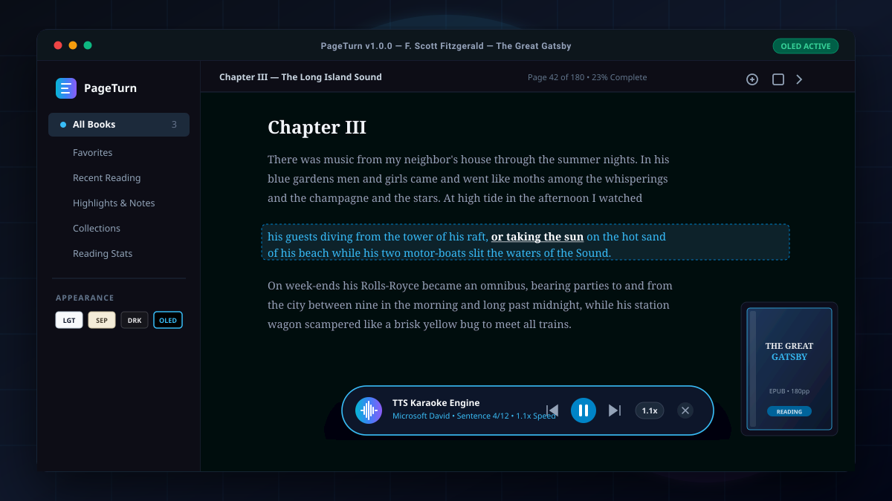

<p align="center">
  
</p>

<h1 align="center">PageTurn</h1>

<p align="center">
  <strong>A modern, cross-platform e-book reader</strong>
</p>

<p align="center">
  <a href="#features">Features</a> •
  <a href="#supported-formats">Formats</a> •
  <a href="#installation">Installation</a> •
  <a href="#development">Development</a> •
  <a href="#architecture">Architecture</a> •
  <a href="#keyboard-shortcuts">Shortcuts</a> •
  <a href="#contributing">Contributing</a>
</p>

---

## Screenshots

<p align="center">
  
</p>

---

## Features

### 🎙️ Floating TTS Karaoke Player & Accessibility
- **Synchronized Karaoke Highlighting**: Real-time sentence and word-level visual karaoke highlighting while reading aloud.
- **Floating Player Bar**: Floating playback HUD with play, pause, sentence-skip backward/forward, and auto-scroll to current speaking point.
- **Voice & Engine Selection**: Native speech synthesis integration with system voice selector.
- **Speed Pitch & Rate Controls**: Granular speed presets from 0.5x to 2.0x for rapid skimming or careful study.

### 🎨 4 High-Contrast & Eye-Care Themes
- **Light Theme**: Clean, high-legibility studio lighting for bright rooms.
- **Sepia Parchment**: Soft, warm paper tone reducing eye fatigue during long reading sessions.
- **Dark Studio**: Modern charcoal dark mode for low-light evening environments.
- **OLED Pure Black**: True `#000000` pitch black background engineered for OLED displays and battery savings.

### 📚 Library Management
- Import books via drag-and-drop or file picker
- Grid and list view with sorting (title, author, date added, last read)
- Organize books into collections/shelves with custom colors
- Tag-based organization
- Reading progress tracking per book
- Automatic folder scanning for new books
- Cover art extraction and display
- Search and filter by format or tag

### 📖 Reader
- Paginated and continuous scroll view modes
- Single-page, double-page, and auto spread layouts
- Customizable fonts, font size, line spacing, margins, and text alignment
- Light, dark, and sepia themes with system-auto detection
- Custom background and foreground colors
- Zoom and fit modes (fit width, fit page, custom)
- Right-to-left reading support
- Full-screen reading mode
- Reading position persistence (EPUB CFI, page numbers, scroll offsets)

### ✏️ Annotations
- Highlight text in five colors (yellow, green, blue, pink, orange)
- Add notes to highlighted passages
- Bookmarks with chapter tracking
- Export annotations as Markdown or JSON
- Annotation panel with search and filtering

### 📄 Format Support
- EPUB 2 & 3 (reflowable and fixed-layout)
- PDF with zoom and fit controls
- MOBI / AZW3 / KF8 (Kindle formats)
- FictionBook (FB2 / FB2.zip)
- Comic archives (CBZ / CBR)
- Plain text, HTML, Markdown, DOCX
- Automatic DRM detection (EPUB & MOBI)
- Automatic format detection via magic bytes

### 📊 Statistics
- Reading session tracking (time spent, pages read)
- Library-wide stats (total books, total reading time, books completed)

---

## Supported Formats

| Format    | Extensions              | Rendering Engine         |
|-----------|-------------------------|--------------------------|
| EPUB      | `.epub`                 | foliate-js               |
| PDF       | `.pdf`                  | pdfjs-dist               |
| MOBI      | `.mobi`                 | foliate-js               |
| AZW3/KF8  | `.azw3`, `.kf8`         | foliate-js               |
| FictionBook | `.fb2`, `.fb2.zip`    | foliate-js               |
| CBZ       | `.cbz`                  | Built-in (image viewer)  |
| CBR       | `.cbr`                  | Built-in (requires unrar)|
| Plain Text| `.txt`                  | Built-in                 |
| HTML      | `.html`, `.htm`         | Built-in (webview)       |
| Markdown  | `.md`, `.markdown`      | marked                   |
| DOCX      | `.docx`                 | mammoth                  |

---

## Installation

### Prerequisites

- **Node.js** 18+ ([download](https://nodejs.org/))
- **npm** 9+

### Setup

```bash
# Clone the repository
git clone https://github.com/yashwantraj147-eng/pageturn.git
cd pageturn

# Install dependencies
npm install

# Start in development mode
npm run dev
```

> **Note on native modules:** PageTurn uses `better-sqlite3`, which requires native compilation. The `postinstall` script handles this automatically. If you encounter issues, run:
> ```bash
> npm run postinstall
> # or
> npx electron-rebuild
> ```

---

## Development

| Command                | Description                                     |
|------------------------|-------------------------------------------------|
| `npm run dev`          | Start in development mode with hot reload       |
| `npm run build`        | Build for production                            |
| `npm run test`         | Run tests                                       |
| `npm run test:watch`   | Run tests in watch mode                         |
| `npm run package`      | Package as installer for current platform       |
| `npm run package:win`  | Package as Windows installer                    |
| `npm run package:mac`  | Package as macOS installer                      |
| `npm run package:linux`| Package as Linux installer                      |

---

## Architecture

```
pageturn/
├── src/
│   ├── main/                  # Electron main process
│   │   ├── index.ts           # Main entry point, window creation
│   │   └── format-detect.ts   # Magic-byte format detection & DRM checks
│   ├── renderer/              # Electron renderer process (React)
│   │   ├── components/        # React UI components
│   │   ├── stores/            # Zustand state stores
│   │   ├── hooks/             # Custom React hooks
│   │   ├── lib/               # Utility functions
│   │   └── App.tsx            # Root React component
│   └── shared/                # Code shared between main & renderer
│       ├── types.ts           # TypeScript types & interfaces
│       └── constants.ts       # App constants, theme definitions, shortcuts
├── resources/                 # App icons and static assets
├── tests/                     # Vitest unit tests
├── dist/                      # Compiled output (git-ignored)
├── dist-electron/             # Electron build output (git-ignored)
├── package.json
├── vite.config.ts
├── vitest.config.ts
├── tailwind.config.ts
└── tsconfig.json
```

### Main Process (`src/main/`)
The Electron main process handles file system access, the SQLite database (via `better-sqlite3`), format detection, cover extraction, and window management. All file and database operations are exposed to the renderer through a typed IPC channel map.

### Renderer Process (`src/renderer/`)
The React-based UI uses Radix UI primitives for accessible dialogs, menus, popovers, and more. Styling is handled by Tailwind CSS with `class-variance-authority` and `tailwind-merge`. State management uses Zustand stores.

### Shared (`src/shared/`)
Contains TypeScript types (`BookMeta`, `Annotation`, `ReaderSettings`, `IpcChannels`, etc.) and constants (format signatures, theme definitions, keyboard shortcuts) used by both processes.

### IPC Layer
All communication between main and renderer processes goes through typed IPC channels defined in `IpcChannels`. This provides full type safety for arguments and return values across the process boundary.

---

## Technology Stack

| Category       | Technology                                      |
|----------------|-------------------------------------------------|
| Framework      | Electron 33                                     |
| Frontend       | React 18, TypeScript 5                          |
| Bundler        | Vite 6 + vite-plugin-electron                   |
| Styling        | Tailwind CSS 3, Radix UI, Lucide Icons          |
| State          | Zustand 5                                       |
| Database       | better-sqlite3                                  |
| EPUB/MOBI      | foliate-js                                      |
| PDF            | pdfjs-dist                                      |
| DOCX           | mammoth                                         |
| Markdown       | marked                                          |
| Testing        | Vitest                                          |
| Packaging      | electron-builder                                |

---

## Keyboard Shortcuts

| Action            | Shortcut                     |
|-------------------|------------------------------|
| Next Page         | <kbd>→</kbd> / <kbd>Space</kbd> |
| Previous Page     | <kbd>←</kbd>                 |
| Search            | <kbd>Ctrl+F</kbd>            |
| Bookmark          | <kbd>Ctrl+B</kbd>            |
| Full Screen       | <kbd>F11</kbd>               |
| Increase Font     | <kbd>Ctrl+=</kbd>            |
| Decrease Font     | <kbd>Ctrl+-</kbd>            |
| Table of Contents | <kbd>Ctrl+T</kbd>            |
| Library           | <kbd>Ctrl+L</kbd>            |
| Open File         | <kbd>Ctrl+O</kbd>            |

---

## Known Limitations

- **DRM-protected books are not supported** — this is by design; PageTurn does not and will not include DRM circumvention.
- **Some complex EPUB3 features** (MathML, advanced media overlays) may have limited support.
- **PDF rendering may be slower** for very large files due to client-side rendering via pdfjs-dist.
- **CBR (RAR-based comic archives)** require unrar system support to be installed.
- **foliate-js integration** for MOBI/AZW3 depends on library compatibility and may not handle all edge cases in older Kindle formats.

---

## Contributing

Contributions are welcome! Here's how to get started:

1. **Fork** the repository.
2. **Create a branch** for your feature or fix:
   ```bash
   git checkout -b feature/my-feature
   ```
3. **Make your changes** and add tests where appropriate.
4. **Run the test suite** to ensure everything passes:
   ```bash
   npm run test
   ```
5. **Commit** with a descriptive message and **push** your branch.
6. **Open a Pull Request** against `main`.

Please follow existing code style and conventions. All new features should include appropriate TypeScript types.

---

## License

[MIT](LICENSE) © 2026 Yashwant Raj
